# Console super admin — guide

La console super admin (`https://admin.<domaine>`) sert à gérer la plateforme : les **clients** (une instance par bar, sur son sous-domaine, avec sa propre base de données), les **formules d'abonnement**, les **paiements** et les **statuts** (essai, relances, délai de grâce, lecture seule, suspension), les **API de messagerie** communes à tous les bars, les **mises à jour**, les **sauvegardes** et l'**assistance** avec l'accord du client.

**Confidentialité.** La console ne montre jamais les données commerciales des bars (ventes, clients, dettes) : seulement ce qui concerne l'abonnement et des nombres d'utilisation (personnes actives, dernière connexion, établissements actifs, messages envoyés dans le mois). La sauvegarde d'une instance contient, elle, toutes ses données : elle est inscrite au journal de la console et à celui du bar.

Sommaire : [1. Installer la console](#1-installer-la-console-sur-lws) · [2. Se connecter](#2-se-connecter) · [3. Tableau de bord](#3-tableau-de-bord) · [4. Formules](#4-formules) · [5. Créer un client](#5-créer-un-client-et-installer-son-instance) · [6. Abonnement et paiements](#6-abonnement-et-paiements) · [7. Statuts](#7-les-statuts-et-leur-calendrier) · [8. Relances d'abonnement](#8-relances-dabonnement) · [9. Messagerie](#9-api-de-messagerie) · [10. Mises à jour](#10-mises-à-jour-des-instances) · [11. Sauvegardes](#11-sauvegardes) · [12. Assistance](#12-assistance-avec-laccord-du-client) · [13. Tâches cron](#13-tâches-cron-dans-cpanel) · [14. Journal, compte, dépannage](#14-journal-mon-compte-dépannage)

---

## 1. Installer la console sur LWS

L'hébergement est un **hébergement mutualisé LWS avec cPanel**, sans accès SSH nécessaire : tout se fait avec le gestionnaire de fichiers, « Bases de données MySQL », « Domaines » et « Tâches Cron » de cPanel, puis la page d'installation de la console.

1. **Déposer le code** dans un dossier hors de `public_html`, par exemple `/home/moncompte/restau-bar-pos` (voir le guide d'installation LWS de l'archive). Le dossier `public/` du projet est la seule partie servie sur le web.
2. **Sous-domaine de la console** : cPanel > **Domaines** (ou *Sous-domaines*) > **Créer un domaine** : `admin.mondomaine.cd`, **racine du document** = le dossier `public/` du projet (`/home/moncompte/restau-bar-pos/public`). Décochez la création d'un nouveau dossier. Chaque sous-domaine de bar aura la **même** racine.
3. **Base de la console** : cPanel > **Bases de données MySQL** :
   - *Créer une base* : `rbpconsole` (LWS l'appelle `moncompte_rbpconsole`) ;
   - *Ajouter un utilisateur* : `rbpconsole` (devient `moncompte_rbpconsole`), mot de passe fort (bouton *Générateur de mot de passe*, notez-le) ;
   - *Ajouter un utilisateur à la base* : cet utilisateur, cette base, **TOUS LES PRIVILÈGES**.
4. **HTTPS** : cPanel > **SSL/TLS Status** (ou *Let's Encrypt* chez LWS) : certificat pour `admin.mondomaine.cd`.
5. **Page d'installation** : ouvrez `https://admin.mondomaine.cd`. Tant que la console n'est pas installée, toute adresse mène à `/installation` :
   1. **Preuve d'accès à l'hébergement** : la page affiche un nom de fichier (par exemple `installation-3f9a1c0b7d2e.txt`). Avec le **gestionnaire de fichiers** de cPanel, créez ce fichier **vide**, avec exactement ce nom, dans le dossier `storage/` du projet. (Sans cette preuve, n'importe qui pourrait s'approprier une console fraîchement déposée.) Autre possibilité : mettre une longue chaîne au hasard dans `jeton_installation` de `config/console.php` et la saisir dans la page.
   2. **Base de la console** : hôte `localhost`, port `3306`, nom et utilisateur **complets** (`moncompte_rbpconsole`), mot de passe → *Tester et enregistrer*. La page écrit `config/console.php`. Si le dossier `config/` n'est pas accessible en écriture, elle affiche le contenu du fichier : créez `config/console.php` dans le gestionnaire de fichiers, collez, enregistrez, rechargez la page.
   3. **Premier super admin** : nom, e-mail, mot de passe de **12 caractères au moins** → la page crée les tables de la console (`database/console/schema.sql` et ses migrations) et le compte, efface le fichier de preuve, puis **disparaît pour toujours** (elle répond « page introuvable » dès qu'un super admin existe).

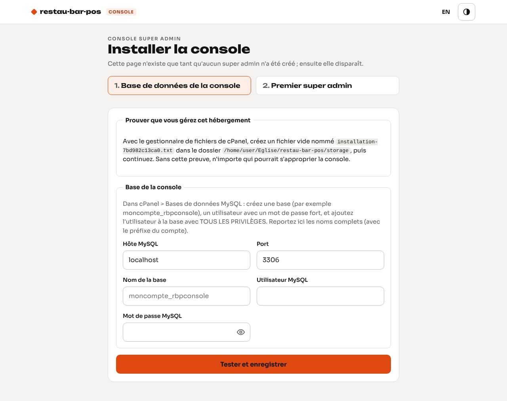

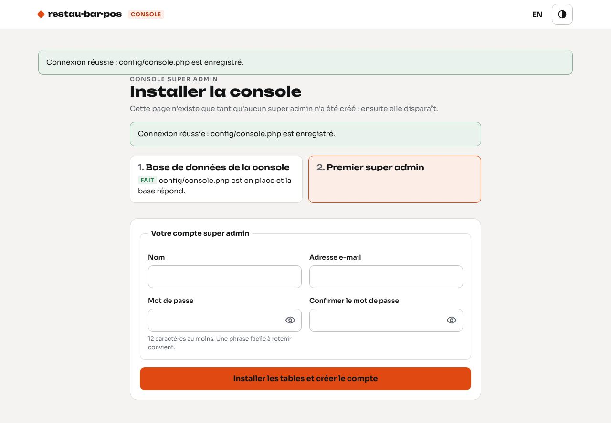

**Sans la page (accès SSH ou terminal cPanel)** : copiez `config/console.php.dist` en `config/console.php`, remplissez la base, puis :

```sh
php bin/console-admin.php installer                      # tables de la console
php bin/console-admin.php admin --email=moi@mondomaine.cd --nom="Prénom Nom"   # mot de passe tiré au hasard et affiché
php bin/console-admin.php migrer                         # après une mise à jour du code
php bin/console-admin.php desactiver --email=ancien@mondomaine.cd
```

`config/console.php` n'est pas versionné (il contient un mot de passe). Il sert aussi aux **instances** : chacune y lit la base de la console pour connaître son abonnement. **Sans ce fichier, il n'y a pas de console : les instances fonctionnent sans aucune limite** (développement, démonstration). Réglage `cache_licence_secondes` (300 par défaut) : chaque instance relit son abonnement au plus toutes les 5 minutes, et **toujours** à l'ouverture de la caisse.

## 2. Se connecter

`https://admin.mondomaine.cd/connexion` : e-mail et mot de passe. Après **5 essais faux**, le compte est bloqué **5 minutes** (par navigateur et par compte : changer de navigateur ne donne pas d'essais en plus). La session (cookie `rbp_console`, distinct de celui des bars) s'arrête après une heure sans activité. Tous les formulaires sont protégés contre la falsification de requête (jeton CSRF) ; un formulaire trop ancien affiche « Formulaire expiré ».

Les écrans : **Tableau de bord**, **Clients**, **Formules**, **API de messagerie**, **Réglages**, **Journal**, **Mon compte** (barre latérale sur ordinateur, barre du bas sur téléphone). Bouton ◐ : thème jour ou nuit ; **EN / FR** : langue.

## 3. Tableau de bord

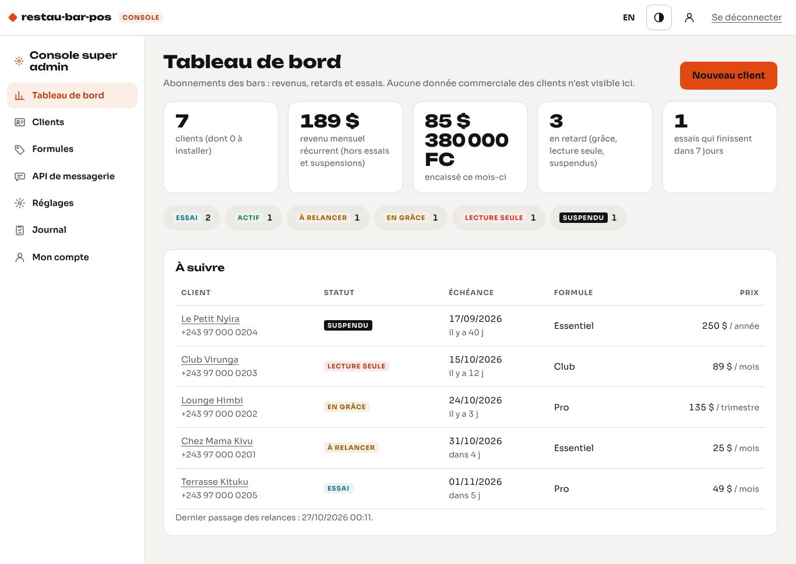

| Chiffre | Calcul |
|---|---|
| Clients | tous les clients, dont ceux dont l'instance n'est pas encore installée |
| Revenu mensuel récurrent | somme des prix des formules en cours, ramenés au mois (prix trimestriel ÷ 3, annuel ÷ 12), **sans** les essais ni les suspendus |
| Encaissé ce mois-ci | paiements enregistrés ce mois-ci (non annulés), **par devise** (USD, CDF) |
| En retard | clients en grâce, en lecture seule ou suspendus |
| Essais qui finissent | essais dont l'échéance est dans 7 jours ou moins |

Les puces de statut mènent à la liste filtrée. « À suivre » liste les clients à relancer, en retard et les essais qui finissent, du plus en retard au moins en retard. La dernière ligne dit quand les relances d'abonnement sont passées : si elle reste vide, la tâche cron ne tourne pas (section 13).

## 4. Formules

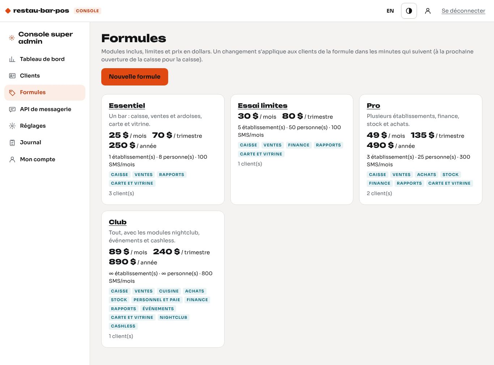

Une formule contient :

- **Modules inclus** : cochez-les dans la liste (elle vient de `App\Core\Modules::offre()` : les modules de l'écran d'accueil des bars, plus les modules à venir, marqués « Bientôt » : cuisine, nightclub, événements, cashless). **Paramètres** (établissements, utilisateurs, mon compte, aide) est toujours inclus. Dans un bar, un module non inclus **disparaît** de l'écran des modules et ses écrans répondent « Module non inclus » avec le nom de la formule et votre contact. Un nouveau module ajouté au code n'entre dans aucune formule tant que vous ne le cochez pas.
- **Limites** : établissements actifs au plus, personnes actives au plus (toutes les personnes actives du bar, avec ou sans mot de passe, serveurs à PIN compris ; le compte d'assistance ne compte pas). Vide = sans limite. Au-delà, la création (ou la réactivation) d'un établissement ou d'une personne est refusée avec un message clair. Rien n'est désactivé si vous baissez une limite : seules les nouvelles créations sont refusées.
- **Prix en dollars** par mois, trimestre et année ; laissez vide une période non proposée.
- **SMS compris par mois** : la console compte les SMS envoyés par chaque bar (section 9) ; ce qui dépasse est à refacturer.
- **Archivée** : plus proposée aux nouveaux clients ; les clients actuels la gardent. Une formule jamais attribuée peut être supprimée.

Une formule modifiée s'applique à ses clients en quelques minutes (et à la prochaine ouverture de la caisse pour la caisse).

## 5. Créer un client et installer son instance

Sur LWS, le sous-domaine et la base de chaque bar se créent **à la main** dans cPanel ; la console guide, teste, puis installe.

### 5.1 Le client et son abonnement

**Clients > Nouveau client** :

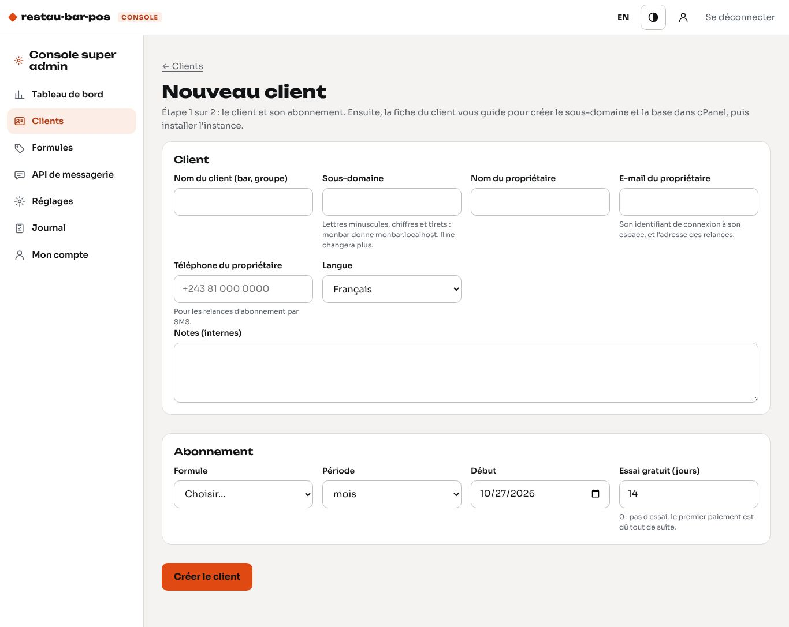

- **Nom du client** (bar ou groupe) et **sous-domaine** : lettres minuscules, chiffres et tirets (`chezmama` donne `chezmama.mondomaine.cd`) ; `admin`, `www`, `api` et `mail` sont réservés. Le sous-domaine ne change plus.
- **Propriétaire** : nom, **e-mail** (obligatoire : c'est son identifiant de connexion et l'adresse des relances), **téléphone** (pour les relances par SMS ; `0970 000 111` est enregistré `+243970000111`), langue.
- **Formule**, **période** (mois, trimestre, année), **début**, **essai gratuit** en jours (14 proposés ; 0 = pas d'essai, le premier paiement est dû tout de suite).

Le client est créé avec le badge **À installer**, et sa fiche affiche les étapes d'installation.

### 5.2 Les étapes dans cPanel

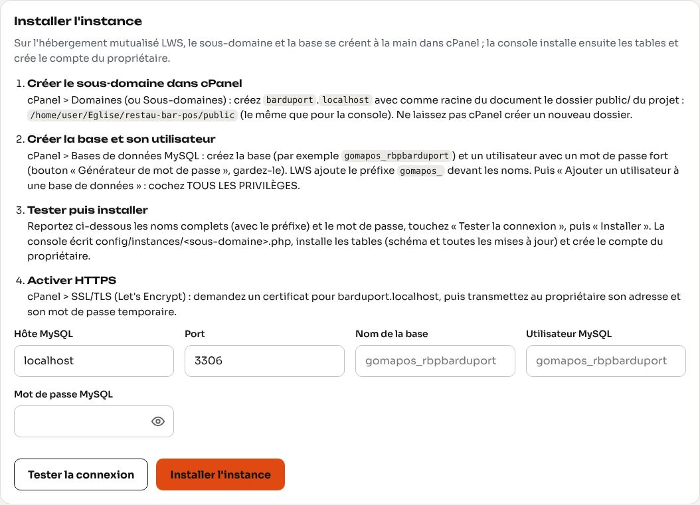

1. **Sous-domaine** : cPanel > **Domaines** > *Créer un domaine* : `chezmama.mondomaine.cd`, **racine du document** = le dossier `public/` du projet, celui qu'affiche la fiche (par exemple `/home/moncompte/restau-bar-pos/public`), le même que pour la console. **Ne laissez pas cPanel créer un nouveau dossier** (décochez « partager la racine » / « créer le dossier » selon l'écran).
2. **Base et utilisateur** : cPanel > **Bases de données MySQL** :
   - *Créer une base* : par exemple `rbpchezmama` ; LWS la nomme `moncompte_rbpchezmama` (le préfixe du compte est ajouté devant ; réglez ce préfixe dans **Réglages** pour que la console propose les bons noms) ;
   - *Ajouter un utilisateur* : par exemple `rbpchezmama` → `moncompte_rbpchezmama`, mot de passe fort (*Générateur de mot de passe* ; copiez-le) ;
   - *Ajouter un utilisateur à une base de données* : cet utilisateur, cette base, cochez **TOUS LES PRIVILÈGES**, *Effectuer des modifications*.
3. **Tester puis installer** (fiche du client) : hôte `localhost`, port `3306`, nom de la base et utilisateur **complets** (avec le préfixe), mot de passe → **Tester la connexion**.
   - « Connexion réussie (MariaDB …) : base vide, prête pour l'installation » : continuez. Le mot de passe n'est pas réaffiché ; il est gardé 15 minutes dans votre session, il est donc inutile de le retaper pour **Installer l'instance**.
   - « Accès refusé » : utilisateur, mot de passe, ou utilisateur pas ajouté à la base. « Base introuvable » : nom incomplet (préfixe) ou privilèges manquants. « Serveur MySQL injoignable » : l'hôte est `localhost` sur LWS.
   - Une base qui contient déjà des tables est refusée : l'installation ne remplace jamais rien.
4. **Installer l'instance** : la console écrit `config/instances/chezmama.php` (les accès à la base, droits 600), installe les tables (`database/schema.sql` puis **toutes** les migrations `database/migrations/*`, sans données de démonstration), les réglages de départ (nom du client, langue, fuseau horaire de Goma), et crée le **compte propriétaire** (rôle Propriétaire, tous les établissements).
5. **Mot de passe temporaire** : la fiche l'affiche **une seule fois**. Transmettez au propriétaire l'adresse `https://chezmama.mondomaine.cd/gestion`, son e-mail et ce mot de passe. À sa première connexion, la gestion l'envoie sur **Mon compte** pour choisir son propre mot de passe (10 caractères au moins) ; les autres écrans restent fermés tant qu'il ne l'a pas fait.
6. **HTTPS** : cPanel > SSL/TLS > certificat pour `chezmama.mondomaine.cd` (Let's Encrypt).

Si le dossier `config/instances/` n'est pas accessible en écriture, rien n'est installé et la fiche affiche le contenu du fichier à créer ; donnez au dossier les droits 755 dans le gestionnaire de fichiers et recommencez. En cas d'échec pendant l'installation, la fiche donne l'erreur : videz la base dans phpMyAdmin avant de recommencer.

### 5.3 Rattacher une instance existante

Une instance créée en ligne de commande (`php bin/creer-instance.php …`) a un fichier `config/instances/<sous-domaine>.php` mais aucun client : elle apparaît sous **Instances non rattachées** dans la liste des clients, et n'a **aucune limite**. **Rattacher** ouvre le formulaire du client avec le sous-domaine rempli ; à l'enregistrement, la console vérifie la base et le marque installé, sans rien installer.

### 5.4 La fiche du client

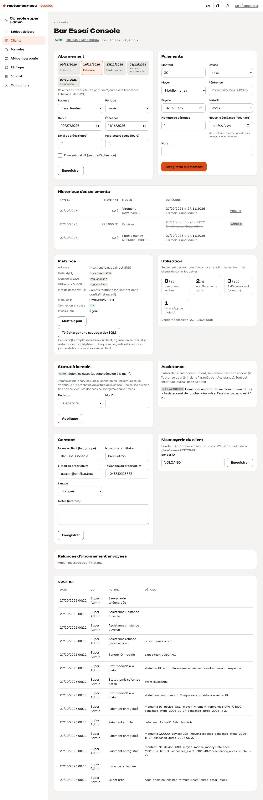

- **Abonnement** : formule, période, début, échéance, essai, délai de grâce et durée de la lecture seule (7 et 15 jours par défaut), avec l'**échéancier** (relances, échéance, fin de la grâce, fin de la lecture seule, suspension ; l'étape actuelle est en couleur).
- **Paiements** (section 6) et leur historique.
- **Instance** : adresse, hôte, base et utilisateur MySQL (le **mot de passe n'est jamais réaffiché**), date d'installation, **connexion à la base** (testée à chaque affichage), mises à jour en attente, boutons **Mettre à jour** et **Télécharger une sauvegarde**.
- **Utilisation** : personnes actives / limite, établissements actifs / limite, SMS du mois / SMS compris, WhatsApp du mois, dernière connexion. Rien d'autre n'est lu dans la base du bar.
- **Statut à la main** (section 7), **Assistance** (section 12), **Contact**, **Messagerie du client** (sender ID propre, section 9), **Relances d'abonnement envoyées**, **Journal** du client.

## 6. Abonnement et paiements

Les paiements sont **notés à la main**, à réception : **Paiements** sur la fiche du client.

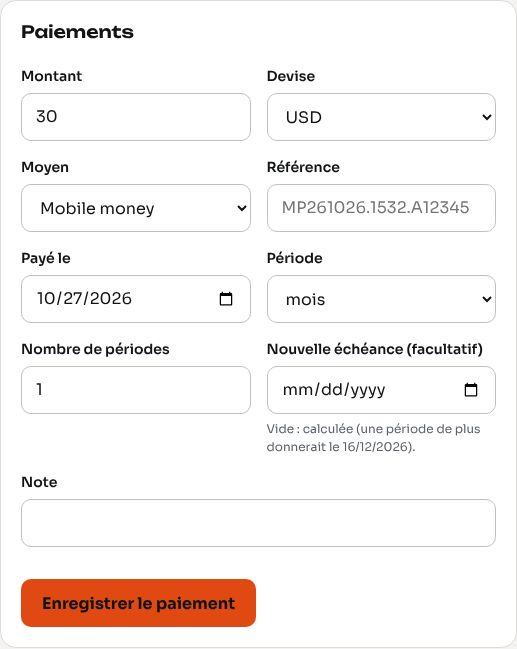

| Champ | |
|---|---|
| Montant et devise | USD ou CDF (le prix de la formule est proposé en dollars) |
| Moyen | Mobile money, Virement, Espèces |
| Référence | obligatoire pour le mobile money et le virement (identifiant de la transaction M-Pesa, Airtel Money, Orange Money, numéro de virement) |
| Payé le | aujourd'hui au plus tard |
| Période et nombre de périodes | par exemple 1 mois, 1 trimestre, 2 trimestres |
| Nouvelle échéance | facultatif : vide = calculée ; la fiche indique la date qu'une période de plus donnerait |

**Calcul de la nouvelle échéance** : on ajoute N périodes **à l'échéance en cours** (un client qui paie en retard, pendant la grâce ou la lecture seule, garde son rythme : il a eu le service). Après une **suspension** selon les dates, on repart **du jour du paiement**. Un mois ajouté au 31 janvier donne le 28 (ou 29) février. Un paiement fait sortir le client de l'essai et fixe sa période.

**Annuler** un paiement saisi par erreur : seul le **dernier paiement encore valable** s'annule, avec un motif ; l'échéance, l'essai et la période reviennent à leur valeur d'avant. Le paiement reste dans l'historique, barré.

## 7. Les statuts et leur calendrier

Le statut se **calcule chaque jour à partir des dates** (chaque bar le calcule aussi avec les dates gardées en cache) :

| Statut | Quand | Dans le bar |
|---|---|---|
| **Essai** | essai gratuit, jusqu'à l'échéance | tout fonctionne ; bandeau « votre essai se termine le … » au propriétaire dans les 7 derniers jours |
| **Actif** | échéance dans plus de 7 jours | tout fonctionne |
| **À relancer** | échéance dans 7 jours ou moins (J-7 … J0) | tout fonctionne ; bandeau au propriétaire ; relances par SMS et e-mail |
| **En grâce** | échéance dépassée, pendant le **délai de grâce** (7 jours par défaut) | tout fonctionne ; bandeau au propriétaire « tout fonctionne jusqu'au … » |
| **Lecture seule** | ensuite, pendant 15 jours par défaut | on **voit** les données, on ne **modifie** plus rien (formulaires de la gestion refusés, sauf connexion, déconnexion, Mon compte et l'accord d'assistance) ; **la caisse ne s'ouvre plus** ; bandeau pour tout le personnel de la gestion ; la vitrine publique reste visible |
| **Suspendu** | ensuite | seule une page explique la suspension, avec votre contact ; la vitrine publique affiche « Menu momentanément indisponible » (rien sur l'abonnement) |

**Jamais en plein service.** Un blocage (lecture seule, suspension, caisse retirée de la formule) s'applique à la **prochaine ouverture de la caisse** : chargement de `/caisse`, connexion par PIN sur une caisse partagée, autorisation d'un appareil, ouverture d'une session de caisse. Une page de caisse **déjà ouverte continue d'encaisser** jusqu'à ce qu'on la recharge ou qu'on la verrouille ; le PIN suivant est refusé. À l'ouverture de la caisse, le bar relit toujours son abonnement dans la console (pas de cache). Les **données ne sont jamais supprimées**.

**Statut à la main** (fiche > *Statut à la main*), avec un **motif obligatoire**, inscrit au journal :

- **Suspendre** : suspendu, même si l'échéance est loin (chèque sans provision, fin de contrat) ;
- **Mettre en lecture seule** ;
- **Garder actif** : actif malgré le retard (promesse de paiement) ;
- **Réactiver : selon les dates** : retire la décision ; si l'échéance est passée depuis longtemps, le client reste suspendu selon les dates : enregistrez son paiement, ou choisissez « Garder actif ».

Un statut décidé à la main n'est pas relancé. Si la base de la console est injoignable, chaque bar continue avec son **dernier abonnement connu** (les dates restent appliquées) ; un bar qui n'a jamais lu son abonnement reste libre.

## 8. Relances d'abonnement

Le script `bin/console-relances.php` (tâche cron chaque heure, section 13) écrit au **propriétaire** de chaque bar, **par SMS** (compte Africa's Talking de la plateforme, sender ID de la plateforme) **et par e-mail**, dans la langue du client :

- aux **étapes** réglées (Réglages, `-7,-3,-1,1` par défaut : 7 jours avant l'échéance, 3 jours avant, la veille, le lendemain) — le texte change pour un essai (« votre essai gratuit se termine ») et après l'échéance (« fonctionne jusqu'au …, puis passe en lecture seule ») ;
- un **avis** au passage en lecture seule et un autre à la suspension.

Chaque message (client, échéance, étape, canal) ne part **qu'une fois**. Un passage manqué (serveur arrêté) est rattrapé pendant deux jours. Les SMS partent à partir de l'**heure d'envoi** (9 h par défaut, heure de Goma). Sans SMS ou sans e-mail réglé, le message est seulement inscrit (« Inscrit sans envoi »). Tout est visible sur la fiche (*Relances d'abonnement envoyées*) et dans **Journal > Messages**. En cas d'échec d'envoi, le script sort avec le code 2 (cPanel peut vous l'envoyer par e-mail).

Pour essayer un jour donné : `php bin/console-relances.php --date=2026-11-24` (ou `--maintenant` pour ne pas attendre l'heure d'envoi).

**E-mail** : créez une adresse dans cPanel > **Comptes de messagerie** (par exemple `abonnements@mondomaine.cd`) et saisissez-la dans **Réglages > Adresse d'envoi des e-mails**. Les e-mails partent par la fonction `mail()` de PHP de l'hébergement.

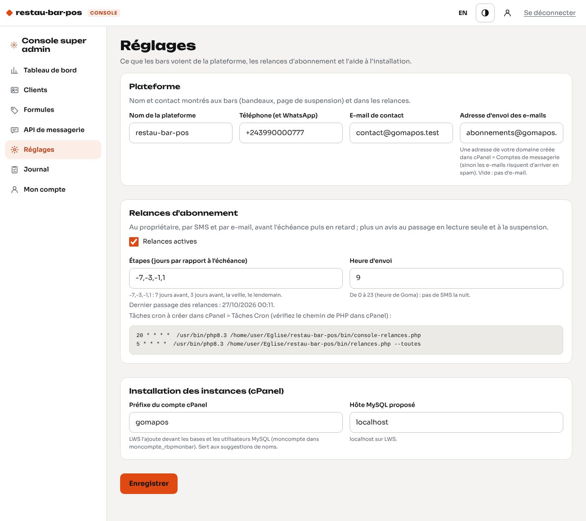

## 9. API de messagerie

Un **seul compte Africa's Talking** et un **seul numéro WhatsApp Business** servent à tous les bars ; ils se règlent dans **API de messagerie**. Les clés ne sont jamais réaffichées (`•••• 1234`) : laissez le champ vide pour garder la valeur, cochez **Effacer** pour la retirer. Guides pas à pas : [Africa's Talking](plateformes/africastalking.md), [WhatsApp Business](plateformes/whatsapp-business.md).

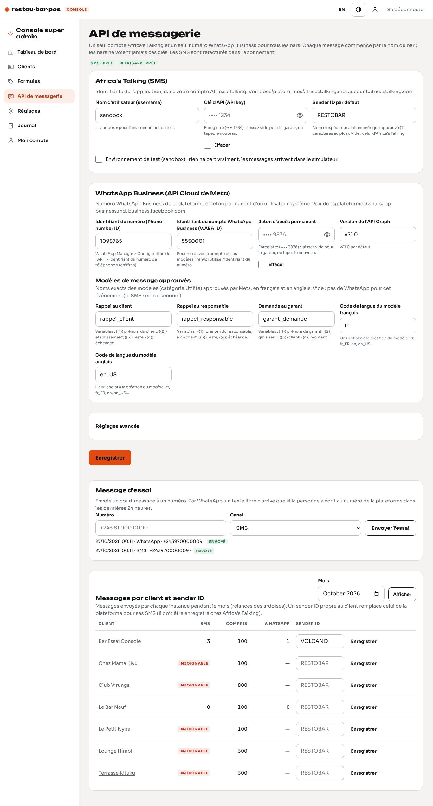

- **Message d'essai** : SMS ou WhatsApp vers un numéro (le WhatsApp en texte libre n'arrive que dans la fenêtre de 24 heures).
- **Messages par client et sender ID** : pour un mois, les SMS et WhatsApp envoyés par chaque bar (relances des ardoises), comparés aux SMS compris dans sa formule ; le dépassement est signalé, à refacturer. Le **sender ID propre** à un bar (par exemple `VOLCANO`, enregistré chez Africa's Talking) remplace celui de la plateforme pour ses SMS.
- Chaque bar garde ses propres réglages de relance (Paramètres > Messagerie : étapes, canal, responsable, heure d'envoi) et voit seulement si les canaux sont prêts.

## 10. Mises à jour des instances

Après chaque mise à jour du code (nouvelle version déposée par le gestionnaire de fichiers ou l'archive), les nouvelles **migrations** (`database/migrations/NNN_nom.sql`) doivent être appliquées à chaque base. Sans SSH, cela se fait depuis la console :

- **Clients > Mettre à jour toutes les instances** : applique les migrations en attente de chaque instance installée ;
- ou, sur une fiche, **Instance > Mettre à jour** (la ligne *Mises à jour* indique « À jour » ou « N en attente : … »).

Chaque mise à jour est inscrite au journal de la console et à celui du bar. La console elle-même a ses migrations (`database/console/migrations/`) : `php bin/console-admin.php migrer`, ou automatiquement par la page d'installation. Avec SSH : `php bin/migrer.php --toutes` fait la même chose que le bouton.

## 11. Sauvegardes

**Instance > Télécharger une sauvegarde (SQL)** : la console écrit en PHP (sans `mysqldump`, absent des hébergements mutualisés) un fichier `rbp-<sous-domaine>-AAAAMMJJ-HHMMSS.sql` avec la structure et toutes les lignes de chaque table, et le télécharge. Gardez-le hors du serveur (ordinateur, disque, stockage en ligne). La sauvegarde est inscrite au **journal de la console** et au **journal du bar** (« Sauvegarde téléchargée par la plateforme »).

**Restaurer** : cPanel > phpMyAdmin > la base du client (vide ou à remplacer) > **Importer** > le fichier `.sql`. Le fichier commence par `SET FOREIGN_KEY_CHECKS = 0` et recrée chaque table (`DROP TABLE IF EXISTS`), il remplace donc les tables existantes.

LWS fait aussi ses propres sauvegardes de l'hébergement ; la sauvegarde de la console permet d'en garder une copie à vous, instance par instance.

## 12. Assistance avec l'accord du client

Le support n'entre dans l'espace d'un bar **qu'avec l'accord de son propriétaire** :

1. Le propriétaire ouvre **Paramètres > Assistance** dans sa gestion et touche **Autoriser l'assistance pendant 24 h** (il peut retirer son accord à tout moment ; seul un propriétaire le peut).

   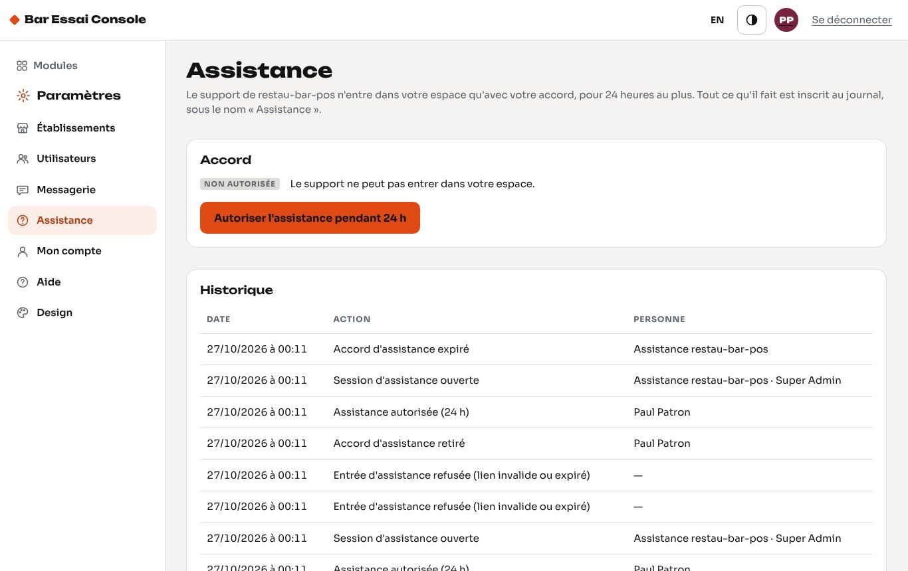

2. Sur la fiche du client, la console affiche « Autorisée jusqu'au … » et le bouton **Ouvrir l'instance** : il crée un **lien à usage unique, valable deux minutes** (seule son empreinte est écrite dans la base du bar) et ouvre la gestion du bar dans un nouvel onglet, connectée avec le compte **« Assistance restau-bar-pos »** (rôle Propriétaire, sans mot de passe ni PIN, actif seulement pendant l'accord, compté nulle part dans les limites).
3. Pendant la session, un bandeau **« Assistance »** est affiché en haut de chaque écran du bar. Tout ce que fait le support est inscrit au journal du bar sous ce nom.
4. Quand l'accord expire (24 h) ou est retiré, la session du support s'arrête à la requête suivante et le compte d'assistance est désactivé.

Journal des deux côtés : la console note chaque ouverture (et chaque refus sans accord) ; le bar note l'accord, son retrait, son expiration, chaque entrée (avec le nom du super admin) et chaque lien refusé.

## 13. Tâches cron dans cPanel

cPanel > **Tâches Cron** (*Cron Jobs*) > *Ajouter une nouvelle tâche cron*. Le chemin de PHP en ligne de commande dépend du serveur LWS : en général `/usr/local/bin/php` (ou, avec plusieurs versions, `/opt/alt/php83/usr/bin/php`) ; vérifiez-le dans cPanel (**Sélecteur de version PHP** ou la documentation LWS), puis remplacez `moncompte` par votre compte cPanel. L'écran **Réglages** de la console affiche les deux lignes avec les chemins de votre serveur.

| Tâche | Minute | Heure | Jour | Mois | Jour de la semaine | Commande |
|---|---|---|---|---|---|---|
| Relances d'abonnement (console) | `20` | `*` | `*` | `*` | `*` | `/usr/local/bin/php /home/moncompte/restau-bar-pos/bin/console-relances.php` |
| Relances des ardoises (tous les bars) | `5` | `*` | `*` | `*` | `*` | `/usr/local/bin/php /home/moncompte/restau-bar-pos/bin/relances.php --toutes` |

En format crontab : `20 * * * * /usr/local/bin/php /home/moncompte/restau-bar-pos/bin/console-relances.php` et `5 * * * * /usr/local/bin/php /home/moncompte/restau-bar-pos/bin/relances.php --toutes`.

Les deux scripts tournent chaque heure et n'envoient qu'à partir de leur heure d'envoi ; un message ne part jamais deux fois. L'adresse e-mail en haut de la page *Tâches Cron* reçoit la sortie des scripts : pour ne recevoir que les problèmes, ajoutez `> /dev/null` à la fin de la commande (les erreurs restent envoyées).

## 14. Journal, Mon compte, dépannage

**Journal** : les 200 dernières actions de la console (connexions, clients, paiements et annulations, statuts à la main, formules, réglages, mises à jour, sauvegardes, assistance) avec qui et quand ; onglet **Messages** : relances d'abonnement et messages d'essai.

**Mon compte** : changer son mot de passe (12 caractères au moins). Un autre super admin se crée avec `php bin/console-admin.php admin --email=…` (qui sert aussi à réinitialiser un mot de passe oublié et à débloquer un compte) ; sans SSH, demandez-le à LWS ou utilisez une tâche cron ponctuelle.

| Problème | Que faire |
|---|---|
| « Base de la console injoignable » | vérifier `config/console.php` (nom complet avec le préfixe, mot de passe) et MySQL dans cPanel ; les bars continuent avec leur dernier abonnement connu |
| Une instance « Injoignable » sur sa fiche | la base du bar ou son fichier `config/instances/<sous-domaine>.php` a un problème (mot de passe MySQL changé dans cPanel : corriger le fichier avec le gestionnaire de fichiers) |
| Le bar ne voit pas un changement de formule | il relit son abonnement toutes les 5 minutes (`cache_licence_secondes`) ; la caisse le relit à chaque ouverture |
| « Relances jamais passées » au tableau de bord | la tâche cron `console-relances.php` ne tourne pas : vérifier le chemin de PHP et la commande |
| SMS « Échec » | voir le tableau de dépannage d'[Africa's Talking](plateformes/africastalking.md#12-dépannage) |
| WhatsApp « Échec » | voir les [erreurs WhatsApp](plateformes/whatsapp-business.md#11-erreurs-fréquentes) |
| Mot de passe temporaire du propriétaire perdu | dans la gestion du bar, un autre propriétaire peut changer son mot de passe ; sinon, avec l'accord du bar, ouvrir l'instance (assistance) et lui donner un nouveau mot de passe dans Paramètres > Utilisateurs |

**Fichiers** : `config/console.php` (base de la console ; modèle `config/console.php.dist`), `config/instances/<sous-domaine>.php` (une par bar), `database/console/schema.sql` et `database/console/migrations/` (base de la console), `app/console.php` et `app/routes/console/` (écrans), `app/Console/` (abonnements, clients, formules, relances, sauvegardes), `app/Core/Plateforme.php` (ce que chaque bar applique), `app/Core/Installation.php` (installation commune à la console et à `bin/creer-instance.php`). La variable d'environnement `RBP_CONSOLE_CONFIG` peut désigner un autre fichier que `config/console.php` (tests).
