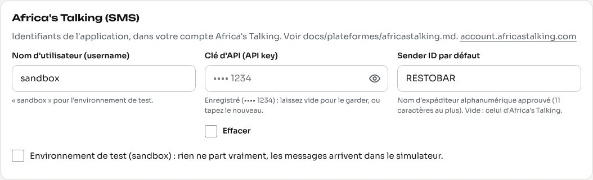
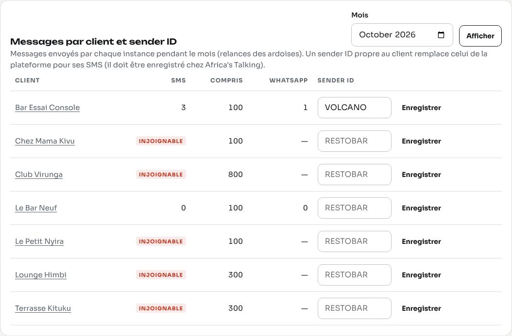

# Africa's Talking : les SMS de la plateforme

Ce guide explique comment ouvrir et régler le compte Africa's Talking qui envoie **tous les SMS de la plateforme** : les relances des ardoises envoyées par chaque bar (au client, au responsable, au garant) et les relances d'abonnement envoyées par la console au propriétaire de chaque bar.

> **Un seul compte pour tous les bars.** Le super admin règle le compte une fois, dans la console (`API de messagerie`). Les bars ne voient jamais la clé ; chaque SMS commence par le nom du bar (« Le Comptoir du Lac : bonjour Furaha… ») ; les SMS sont refacturés dans l'abonnement (chaque formule comprend un nombre de SMS par mois, la console compte ceux de chaque bar).

Les prix, les délais et les écrans d'Africa's Talking changent : ce guide donne la marche à suivre et les ordres de grandeur connus en octobre 2026. Vérifiez toujours sur leur site.

---

## 1. Ce qu'est Africa's Talking

[Africa's Talking](https://africastalking.com) est une plateforme africaine (siège à Nairobi) qui donne accès, par une API, aux opérateurs de téléphonie de nombreux pays africains : SMS, USSD, appels vocaux, crédit de communication. L'application n'utilise que les **SMS** (envoi simple, sans réponse).

Pour la RDC (Congo-Kinshasa, indicatif **+243**), les SMS passent par les opérateurs **Vodacom**, **Airtel**, **Orange** et **Africell**. Le numéro du destinataire est toujours envoyé au format international : `+243970000001` (l'application le normalise elle-même : `0970 000 001` devient `+243970000001`).

## 2. Créer le compte

1. Ouvrez [account.africastalking.com](https://account.africastalking.com) et choisissez **Sign up** (inscription).
2. Saisissez votre nom, l'e-mail de la plateforme (une adresse que vous garderez : elle reçoit les alertes de solde), un mot de passe, puis le pays.
3. Confirmez l'adresse e-mail avec le lien reçu.
4. À la première connexion, Africa's Talking vous demande de créer une **équipe** (*Team*) : donnez-lui le nom de la plateforme (par exemple « restau-bar-pos »). Une équipe contient une ou plusieurs **applications** (*Apps*) ; chaque application a son nom d'utilisateur, sa clé d'API, son solde et ses sender ID.
5. Activez la double authentification du compte (menu du profil) : ce compte peut envoyer des SMS facturés au nom de tous vos clients.

## 3. Vérification de l'entreprise (KYC)

Pour passer en production (envoyer de vrais SMS) et pour demander un sender ID, Africa's Talking vérifie l'entreprise qui envoie (*KYC*, « connaissez votre client »). La liste exacte des documents est affichée dans le compte, au moment de la demande ; préparez en général :

- le **registre de commerce** de l'entreprise (RCCM en RDC) et son identifiant national (Id. Nat.) ou numéro d'impôt ;
- la **pièce d'identité** du dirigeant (ou de la personne qui signe) ;
- un **justificatif d'adresse** de l'entreprise ;
- une description de l'usage : « rappels de paiement envoyés par des bars et restaurants de Goma à leurs clients et à leur personnel ; messages transactionnels, pas de publicité ».

Comptez de quelques jours à deux semaines. Tant que la vérification n'est pas faite, utilisez l'environnement de test (sandbox).

## 4. Environnement de test (sandbox) ou réel (live)

| | Sandbox (test) | Live (réel) |
|---|---|---|
| Nom d'utilisateur (*username*) | toujours `sandbox` | le nom de l'application que vous créez (par exemple `restobarpos`) |
| Clé d'API | celle de l'application sandbox | celle de l'application réelle |
| Adresse de l'API | `https://api.sandbox.africastalking.com/version1/messaging` | `https://api.africastalking.com/version1/messaging` |
| Les SMS arrivent… | dans le **simulateur**, jamais sur un vrai téléphone | sur le téléphone du destinataire |
| Coût | gratuit | débité du solde de l'application |

**Essayer en sandbox :**

1. Dans le compte, ouvrez **Go to Sandbox App** (application de test, déjà créée).
2. Menu **Settings > API Key** : tapez le mot de passe du compte, puis **Generate** ; copiez la clé (elle n'est montrée qu'une fois).
3. Ouvrez le simulateur ([simulator.africastalking.com](https://simulator.africastalking.com), ou **Launch Simulator** dans l'application sandbox) et tapez un numéro (par exemple `+243970000009`) : un faux téléphone s'affiche.
4. Dans la console : `API de messagerie` > Africa's Talking : nom d'utilisateur `sandbox`, la clé, et cochez **Environnement de test (sandbox)**. Enregistrez.
5. `Message d'essai` : envoyez un SMS au numéro du simulateur ; il apparaît sur le faux téléphone.



## 5. Créer l'application réelle et sa clé d'API

1. Dans l'équipe, **Create App** : nom (il deviendra le *username*, par exemple `restobarpos`), pays et devise proposés par Africa's Talking.
2. Ouvrez l'application, puis **Settings > API Key** > **Generate**. Copiez la clé tout de suite : Africa's Talking ne la remontre plus.
3. **Régénérer la clé** (fuite, départ d'une personne) : même écran ; l'ancienne clé cesse de fonctionner immédiatement. Saisissez aussitôt la nouvelle dans la console, sinon les SMS échouent (erreur HTTP 401).
4. Dans la console : nom d'utilisateur = celui de l'application, la clé, **décochez** « Environnement de test ». Le champ de la clé ne réaffiche jamais la valeur (seulement `•••• 1234`) : laissez-le vide pour garder la clé enregistrée, cochez **Effacer** pour la retirer.

## 6. Recharger le solde (et dans quelle devise)

Chaque SMS est débité du **solde de l'application** (pas de l'équipe). Quand le solde est vide, les SMS échouent avec `InsufficientBalance` (code 405) et la relance est inscrite « Échec » dans le journal du bar.

- Menu de l'application **Payments > Top Up** (ou *Wallet*). Les moyens proposés dépendent du pays : carte bancaire, virement, et mobile money dans certains pays.
- **Devise** : Africa's Talking tient le solde dans une monnaie locale là où il a une filiale (Kenya, Ouganda, Tanzanie, Nigeria…) et **en dollars américains (USD) ailleurs** ; pour une application dont les envois vont vers la RDC, attendez-vous à un solde en USD. Vérifiez la devise affichée dans **Payments** avant de payer.
- Réglez une **alerte de solde bas** (*Low balance notification*) vers l'e-mail de la plateforme.

Ordre de grandeur pour la consommation : un bar qui fait 40 ardoises par mois avec 3 étapes de relance envoie environ 120 à 200 SMS (clients et responsables). Les formules de la console fixent les SMS compris par mois ; l'écran `API de messagerie` > « Messages par client » montre ce que chaque bar a envoyé et ce qui dépasse sa formule.

## 7. Sender ID (nom d'expéditeur) pour la RDC

Sans sender ID enregistré, vos SMS partent avec un expéditeur générique d'Africa's Talking (un numéro ou un nom partagé) : certains opérateurs les filtrent, et vos clients ne reconnaissent pas l'envoi. Il faut donc un **sender ID alphanumérique** : 3 à 11 lettres ou chiffres, sans espace (par exemple `RESTOBAR`, `VOLCANO`).

**Demande :**

1. Dans l'application réelle : **SMS > Sender IDs > Request** (demander un sender ID).
2. Pays : **Congo, The Democratic Republic of the** (RDC, +243). La demande est transmise **à chaque opérateur** : Vodacom, Airtel, Orange et Africell ; chacun l'approuve séparément.
3. Joignez ce qui est demandé, en général :
   - une **lettre d'autorisation** sur papier à en-tête de l'entreprise, signée et cachetée, qui demande l'utilisation du nom (`RESTOBAR`) pour des messages transactionnels ;
   - le **registre de commerce** (RCCM) et la pièce d'identité du signataire ;
   - **2 ou 3 exemples de messages** réels, par exemple : `Le Comptoir du Lac : bonjour Furaha, rappel : votre ardoise de 45 000 FC est à régler avant le 11/11/2026. Merci !` ;
   - le type de trafic : **transactionnel** (rappels, pas de publicité).
4. **Délais** : de quelques jours à plusieurs semaines selon l'opérateur (comptez 2 à 4 semaines pour les quatre). Des frais d'enregistrement peuvent s'appliquer selon l'opérateur ; Africa's Talking les annonce dans la demande.
5. Quand le sender ID est approuvé, saisissez-le dans la console : `API de messagerie` > **Sender ID par défaut**. Tant qu'il n'est pas approuvé par tous les opérateurs, laissez le champ vide (sinon les SMS vers un opérateur qui ne l'a pas encore approuvé échouent avec `InvalidSenderId`).

**Sender ID propre à un bar.** Un bar peut avoir son propre nom d'expéditeur (`VOLCANO` pour le Volcano Club) : faites la même demande pour ce nom (avec une lettre du bar), puis saisissez-le dans la fiche du client (`Messagerie du client`) ou dans le tableau « Messages par client et sender ID ». Ses SMS partent alors avec ce nom au lieu de celui de la plateforme.



## 8. Prix

Africa's Talking facture **chaque SMS envoyé, par destinataire et par tranche de 160 caractères** (voir la longueur, section 10). Le prix dépend du pays et de l'opérateur du destinataire. Pour la RDC, comptez un ordre de grandeur de **quelques centimes de dollar par SMS** ; les prix changent souvent : consultez la [page des prix d'Africa's Talking](https://africastalking.com/pricing) (onglet SMS, pays « DR Congo ») avant de fixer le nombre de SMS compris dans vos formules et le prix des SMS supplémentaires.

La réponse de l'API donne le coût de chaque envoi (`cost`, par exemple `USD 0.0200`).

## 9. Ce que l'application envoie à l'API

Une requête par message :

```
POST https://api.africastalking.com/version1/messaging
apiKey: <clé d'API>
Accept: application/json
Content-Type: application/x-www-form-urlencoded

username=restobarpos&to=%2B243970000001&message=Le+Comptoir+du+Lac+%3A+bonjour+Furaha...&from=RESTOBAR
```

| Champ | Contenu |
|---|---|
| `username` | nom d'utilisateur de l'application (`sandbox` en test) |
| `to` | numéro du destinataire, format international (`+243…`) |
| `message` | texte du SMS, qui commence par le nom du bar |
| `from` | sender ID (celui du bar s'il en a un, sinon celui de la plateforme) ; absent si aucun n'est réglé |
| en-tête `apiKey` | clé d'API de l'application |

Réponse (extrait) :

```json
{"SMSMessageData": {"Message": "Sent to 1/1 Total Cost: USD 0.0200",
  "Recipients": [{"statusCode": 101, "number": "+243970000001", "status": "Success",
                  "cost": "USD 0.0200", "messageId": "ATXid_…"}]}}
```

L'application considère le SMS **accepté** quand `statusCode` vaut **100** (*Processed*), **101** (*Sent*) ou **102** (*Queued*) ; elle garde alors le `messageId`. Tout autre code est un échec : le message est inscrit « Échec » avec le statut renvoyé (par exemple `HTTP 201 InsufficientBalance`), et l'autre canal (WhatsApp) est essayé s'il est réglé.

Code de `statusCode` les plus courants en échec : 401 `RiskHold`, 402 `InvalidSenderId`, 403 `InvalidPhoneNumber`, 404 `UnsupportedNumberType`, 405 `InsufficientBalance`, 406 `UserInBlacklist`, 407 `CouldNotRoute`, 409 `DoNotDisturbRejection`, 500 `InternalServerError`, 501 `GatewayError`, 502 `RejectedByGateway`.

Adresses de remplacement : la console permet de remplacer l'adresse de l'API (`Réglages avancés`), pour des tests avec un faux service ; laissez vide en temps normal.

## 10. Longueur d'un SMS (pourquoi l'application évite les espaces fines)

- Un SMS en **GSM 7 bits** (l'alphabet de base : lettres sans accent, chiffres, ponctuation simple, et quelques accents comme é, è, à, ù) contient **160 caractères** ; au-delà, il est découpé en parties de 153 caractères, **chacune facturée**.
- Un seul caractère hors de cet alphabet (ê, ç, â, une apostrophe typographique ’, un emoji, une **espace fine insécable**…) fait passer **tout le message en Unicode** : **70 caractères** par SMS (67 par partie). Le même texte peut alors coûter deux ou trois fois plus.
- Le français écrit les montants avec une espace fine (« 45 000 FC ») : l'application écrit volontairement les montants des SMS avec des **espaces simples** et des textes sans caractères Unicode, pour rester en GSM 7 bits. Gardez cette règle si vous modifiez les textes des messages (`lang/fr/dettes.php`, `lang/fr/console.php`).

## 11. Accusés de réception (facultatif)

Africa's Talking peut prévenir un serveur quand un SMS est réellement remis (ou refusé) : menu de l'application **SMS > SMS Callback URLs > Delivery Reports**. Il envoie alors un `POST` avec `id` (le `messageId`), `status` (`Success`, `Failed`, `Rejected`, `Buffered`…), `phoneNumber`, `networkCode` et `failureReason`.

L'application ne traite pas encore ces accusés : le journal des messages indique « Envoyé » quand Africa's Talking a accepté le SMS. Pour suivre la remise, consultez **SMS > Outbox** dans le compte, ou demandez cette évolution.

## 12. Dépannage

| Message dans le journal | Cause | Que faire |
|---|---|---|
| `InsufficientBalance` (405) | solde de l'application vide | recharger (section 6) ; les relances échouées ne repartent pas d'elles-mêmes |
| `InvalidSenderId` (402) | sender ID pas (encore) approuvé pour l'opérateur du destinataire | vider le champ sender ID le temps de l'approbation, ou relancer la demande pour cet opérateur |
| `UserInBlacklist` (406) | le destinataire a refusé les SMS de cet expéditeur (liste noire de l'opérateur) | rien à faire côté application ; passer par WhatsApp (canal préféré du client) |
| `DoNotDisturbRejection` (409) | numéro en « ne pas déranger » chez l'opérateur | idem |
| `InvalidPhoneNumber` (403) | numéro mal saisi | corriger le téléphone du client dans le bar |
| `CouldNotRoute` (407), `RejectedByGateway` (502) | l'opérateur ne prend pas le message | réessayer plus tard ; si cela dure, contacter le support d'Africa's Talking |
| `RiskHold` (401) | envoi bloqué par le contrôle des risques (compte récent, contenu suspect) | contacter le support ; vérifier que le KYC est terminé |
| `HTTP 401` (texte « The supplied authentication is invalid ») | mauvais nom d'utilisateur ou clé régénérée | ressaisir le *username* et la clé ; `sandbox` va avec la clé sandbox seulement |
| `réseau : …` | le serveur n'a pas pu joindre Africa's Talking | vérifier l'accès Internet du serveur ; LWS autorise les requêtes HTTPS sortantes |
| « Inscrit sans envoi » | SMS non réglé dans la console | saisir le nom d'utilisateur et la clé |
| `plateforme de messagerie injoignable` | l'instance n'a pas pu lire la base de la console | vérifier `config/console.php` et MySQL |

## 13. Où saisir les réglages

Console super admin > **API de messagerie** > **Africa's Talking (SMS)** :

- **Nom d'utilisateur (username)** : `sandbox` ou le nom de l'application réelle ;
- **Clé d'API** : jamais réaffichée (`•••• 1234`) ; vide = garder ; case **Effacer** pour la retirer ;
- **Sender ID par défaut** : celui de la plateforme, une fois approuvé ;
- **Environnement de test (sandbox)** ;
- **Réglages avancés** : autre adresse de l'API (tests seulement).

Puis **Message d'essai** vers votre propre numéro. Le sender ID propre à un bar se règle sur sa fiche (`Messagerie du client`). Voir aussi [WhatsApp Business](whatsapp-business.md) et le [guide de la console](../console.md).
