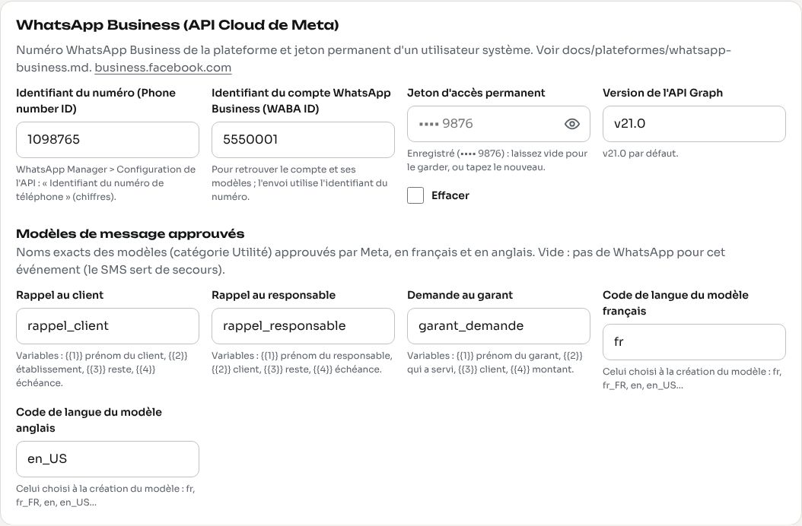

# WhatsApp Business : les messages WhatsApp de la plateforme

Ce guide explique comment ouvrir et régler le **numéro WhatsApp Business de la plateforme** (API Cloud de Meta), qui envoie les relances des ardoises par WhatsApp aux clients qui préfèrent ce canal (le SMS sert de secours).

> **Un seul numéro pour tous les bars.** Le super admin le règle une fois dans la console (`API de messagerie`). Les bars ne voient jamais le jeton. Le nom affiché dans WhatsApp est celui de la plateforme ; le nom du bar est dans le message lui-même (variable du modèle).

Meta change souvent ses écrans, ses prix et ses règles : ce guide donne la marche à suivre connue en octobre 2026. Les liens vers la documentation de Meta font foi.

---

## 1. Ce qu'il faut savoir avant de commencer

- **API Cloud** : Meta héberge l'envoi ; l'application appelle simplement `https://graph.facebook.com`. Pas de serveur WhatsApp à installer, pas de fournisseur intermédiaire.
- **Modèles obligatoires** : une entreprise ne peut écrire la première, ou plus de 24 heures après le dernier message du client, qu'avec un **modèle de message approuvé** par Meta. Toutes les relances de l'application passent donc par trois modèles (section 7).
- **Numéro dédié** : le numéro utilisé ne doit **pas** être déjà enregistré dans l'application WhatsApp ou WhatsApp Business d'un téléphone (ou il faut d'abord supprimer ce compte WhatsApp).
- Il faut un **compte Meta Business** (portefeuille d'entreprise), une **application** sur developers.facebook.com, un **compte WhatsApp Business** (WABA) et un **utilisateur système** pour le jeton permanent.

## 2. Compte Meta Business et vérification de l'entreprise

1. Ouvrez [business.facebook.com](https://business.facebook.com) avec un compte Facebook personnel de la plateforme (celui d'un responsable ; activez la double authentification).
2. Créez le **portefeuille d'entreprise** (*Business portfolio*) : nom légal de l'entreprise, votre nom, e-mail professionnel.
3. **Paramètres de l'entreprise > Centre de sécurité** (ou *Infos sur l'entreprise*) > **Vérifier l'entreprise** (*Start verification*). Meta demande :
   - le nom légal, l'adresse, le téléphone et le site web de l'entreprise (le site doit montrer le même nom) ;
   - un document officiel : registre de commerce (RCCM), document fiscal, ou facture d'un service public au nom de l'entreprise ;
   - une confirmation par e-mail (adresse du domaine du site), par téléphone ou par SMS.
4. Délai : de quelques jours à quelques semaines. **Sans vérification**, vous pouvez déjà développer et tester, mais les limites d'envoi restent basses (section 9) et le nom d'affichage peut être limité.

## 3. Créer l'application (type Business) et ajouter WhatsApp

1. Ouvrez [developers.facebook.com](https://developers.facebook.com) > **Mes apps** > **Créer une app**.
2. Cas d'utilisation : choisissez **Autre**, puis le type **Business** (Entreprise). Nom de l'app : « restau-bar-pos messagerie » ; rattachez-la à votre portefeuille d'entreprise.
3. Dans le tableau de bord de l'app : **Ajouter un produit** > **WhatsApp** > **Configurer**. Meta crée alors (ou vous fait choisir) un **compte WhatsApp Business (WABA)** et vous donne un **numéro de test** gratuit.
4. Menu **WhatsApp > Configuration de l'API** (*API Setup*) : vous y voyez
   - l'**identifiant du numéro de téléphone** (*Phone number ID*) — c'est lui que l'application utilise pour envoyer ;
   - l'**identifiant du compte WhatsApp Business** (*WhatsApp Business Account ID*, WABA ID) — il désigne le compte qui possède les numéros et les modèles ;
   - un **jeton temporaire** (24 heures), pour un premier essai seulement.

**Numéro de test** : il envoie gratuitement, mais seulement vers **5 numéros au plus**, à ajouter et vérifier dans *API Setup* (« À » > *Gérer la liste des numéros*). Un envoi vers un autre numéro échoue avec l'erreur 131030.

## 4. Ajouter et vérifier le vrai numéro

1. **WhatsApp Manager** (business.facebook.com > Comptes WhatsApp) > **Numéros de téléphone** > **Ajouter un numéro**.
2. Saisissez le **nom d'affichage** (*display name*) : le nom de la plateforme, tel qu'il apparaît sur votre site (« restau-bar-pos »). Catégorie : *Restaurant* ou *Services professionnels*.
3. Saisissez le numéro (par exemple +243 99 000 0777), recevez le **code par SMS ou par appel**, tapez-le.
4. Choisissez un **code PIN de vérification en deux étapes** (6 chiffres) et gardez-le : Meta le redemande si le numéro est réenregistré.
5. **Approbation du nom d'affichage** : Meta vérifie que le nom correspond à l'entreprise (en général 1 à 2 jours). Tant qu'il n'est pas approuvé, le numéro envoie peu de messages, ou pas du tout.
6. Relevez l'**identifiant du numéro** (*Phone number ID*) de ce vrai numéro dans *API Setup* : il est différent de celui du numéro de test.

## 5. Jeton permanent avec un utilisateur système

Le jeton de la page *API Setup* expire en 24 heures. Pour l'application, il faut un **jeton permanent** :

1. business.facebook.com > **Paramètres de l'entreprise** > **Utilisateurs > Utilisateurs système** > **Ajouter**. Nom : « restau-bar-pos-api », rôle **Administrateur**.
2. **Attribuer des éléments** (*Assign assets*) :
   - **Apps** : votre app, avec le **contrôle total** ;
   - **Comptes WhatsApp** : votre WABA, avec le **contrôle total**.
3. **Générer un nouveau jeton** : choisissez l'app, l'expiration **Jamais** (*Never*), et cochez les autorisations :
   - `whatsapp_business_messaging` (envoyer les messages) ;
   - `whatsapp_business_management` (gérer le compte et les modèles).
4. Copiez le jeton tout de suite : Meta ne le remontre plus. Collez-le dans la console (`Jeton d'accès permanent`) ; la console ne le réaffiche jamais (seulement `•••• 9876`).
5. En cas de fuite : **Utilisateurs système** > le jeton > **Révoquer**, puis générez-en un nouveau et saisissez-le dans la console.

## 6. Identifiant du numéro ou identifiant du compte ?

| Identifiant | Où le trouver | Sert à |
|---|---|---|
| **Phone number ID** (identifiant du numéro) | *API Setup*, ou WhatsApp Manager > Numéros | **envoyer** : `POST /{phone-number-id}/messages` |
| **WABA ID** (identifiant du compte WhatsApp Business) | *API Setup*, ou WhatsApp Manager > Paramètres du compte | retrouver le compte, ses numéros et ses **modèles** |

La console demande les deux ; l'envoi n'utilise que l'identifiant du numéro.

## 7. Les modèles de message

WhatsApp Manager > **Modèles de message** > **Créer un modèle**. Pour chaque modèle :

- **Catégorie : Utilité** (*Utility*) : rappel lié à une transaction existante. Un texte promotionnel serait reclassé en *Marketing* (plus cher, et refusé par certains clients).
- **Nom** : exactement celui de la console, en minuscules avec « _ » : `rappel_client`, `rappel_responsable`, `garant_demande`.
- **Langues** : créez le modèle en **français** (`fr`) et en **anglais** (`en` ou `en_US`) sous le même nom. Le code choisi doit être recopié dans la console (`Code de langue du modèle français / anglais`).
- **Corps** avec des variables `{{1}}`, `{{2}}`… et un **exemple** pour chacune (Meta l'exige). Le corps ne doit ni commencer ni finir par une variable, et deux variables ne doivent pas se suivre.

L'application remplit les variables **dans cet ordre** :

### `rappel_client` — rappel d'ardoise au client

| Variable | Contenu | Exemple |
|---|---|---|
| `{{1}}` | prénom du client | Furaha |
| `{{2}}` | établissement | Le Comptoir du Lac |
| `{{3}}` | reste à payer | 45 000 FC |
| `{{4}}` | échéance | 11/11/2026 |

Français :
> Bonjour {{1}}, ici {{2}}. Votre ardoise de {{3}} (échéance : {{4}}) reste à régler. Merci de passer la régler dès que possible.

Anglais :
> Hello {{1}}, this is {{2}}. Your tab of {{3}} (due date: {{4}}) is still to be paid. Please come and settle it as soon as you can.

Le même modèle sert avant l'échéance (la veille) et après (J+1, J+7, J+30) : le texte reste vrai dans les deux cas.

### `rappel_responsable` — rappel au membre du personnel responsable de la dette

| Variable | Contenu | Exemple |
|---|---|---|
| `{{1}}` | prénom du responsable | Aline |
| `{{2}}` | client | Furaha Neema |
| `{{3}}` | reste à payer | 45 000 FC |
| `{{4}}` | échéance | 11/11/2026 |

Français :
> Bonjour {{1}}, rappel : l'ardoise de {{2}} dont vous êtes responsable, soit {{3}}, a pour échéance le {{4}}. Merci de suivre son paiement.

Anglais :
> Hello {{1}}, reminder: the tab of {{2}} you are responsible for, {{3}}, is due on {{4}}. Please follow up on its payment.

### `garant_demande` — demande à la personne désignée garante

| Variable | Contenu | Exemple |
|---|---|---|
| `{{1}}` | prénom du garant | Patrick |
| `{{2}}` | qui a servi | Aline Mukeba |
| `{{3}}` | client | Furaha Neema |
| `{{4}}` | montant | 45 000 FC |

Français :
> Bonjour {{1}}, {{2}} vous propose comme garant de l'ardoise de {{3}} ({{4}}). Ouvrez la caisse ou la gestion pour accepter ou refuser.

Anglais :
> Hello {{1}}, {{2}} named you as guarantor for the tab of {{3}} ({{4}}). Open the till or the back office to accept or decline.

**Approbation** : souvent quelques minutes, parfois jusqu'à 24 heures (et plus si Meta révise à la main). Raisons de refus fréquentes :

- contenu promotionnel dans un modèle *Utilité* (le modèle est alors reclassé *Marketing* ou refusé) ;
- variable au début ou à la fin du texte, variables qui se suivent, ou exemples manquants ;
- texte trop vague (« Bonjour {{1}}, {{2}} »), ou ton menaçant pour un rappel de paiement ;
- modèle identique à un autre déjà existant, fautes de format (accolades mal fermées).

Un modèle refusé se corrige et se soumet de nouveau sous le même nom (ou un nouveau nom, à reporter dans la console). Un modèle approuvé dont les clients se plaignent peut être mis en pause ou désactivé par Meta.

Tant qu'un modèle n'est pas réglé dans la console (champ vide), l'application n'envoie pas de WhatsApp pour cet événement : le SMS est utilisé.

## 8. Fenêtre de 24 heures

Quand une personne écrit au numéro de la plateforme, une **fenêtre de service client de 24 heures** s'ouvre : pendant ce temps, l'entreprise peut répondre en **texte libre**. En dehors de cette fenêtre, seuls les **modèles approuvés** passent.

Conséquence : le **message d'essai WhatsApp** de la console est un texte libre ; il n'arrive que si le numéro de test a écrit au numéro de la plateforme dans les dernières 24 heures (sinon erreur 131047). Les relances, elles, utilisent toujours les modèles.

## 9. Prix, limites d'envoi et qualité

**Prix.** Meta facture les **messages de modèle remis**, selon leur catégorie (*Utilité*, *Marketing*, *Authentification*) et le pays du destinataire ; depuis juillet 2025, la facturation se fait **par message** (auparavant par « conversation » de 24 heures). Un modèle *Utilité* envoyé pendant une fenêtre de service client ouverte est gratuit ; les réponses en texte libre dans la fenêtre aussi. La RDC est dans la zone tarifaire « Reste de l'Afrique ». Les prix changent : voir la [page des prix de Meta](https://developers.facebook.com/docs/whatsapp/pricing). Ajoutez un **moyen de paiement** au compte WhatsApp Business (WhatsApp Manager > Facturation), sinon les modèles payants ne partent plus.

**Limites d'envoi** (*messaging limits*) : nombre de personnes différentes à qui l'entreprise peut écrire en premier (modèles) sur 24 heures glissantes. Paliers : **250** (entreprise non vérifiée), puis **1 000**, **10 000**, **100 000**, puis sans limite. Meta monte d'un palier automatiquement quand l'entreprise est vérifiée, que la qualité est bonne et que vous utilisez une bonne part du palier. Au-delà de la limite, les envois échouent (erreur 131048 ou 131056 selon le cas) jusqu'au lendemain.

**Qualité** (*quality rating*) : vert, jaune ou rouge, selon les blocages et signalements des destinataires sur les 7 derniers jours. Une qualité basse empêche de monter de palier et peut faire baisser la limite ; un modèle très signalé est mis en pause. Gardez des rappels utiles, polis, et pas plus d'une fois par étape (l'application ne renvoie jamais deux fois la même relance).

## 10. Ce que l'application envoie à l'API

```
POST https://graph.facebook.com/v21.0/{phone-number-id}/messages
Authorization: Bearer <jeton permanent>
Content-Type: application/json
```

```json
{
  "messaging_product": "whatsapp",
  "to": "243970000002",
  "type": "template",
  "template": {
    "name": "rappel_client",
    "language": { "code": "en_US" },
    "components": [{
      "type": "body",
      "parameters": [
        { "type": "text", "text": "John" },
        { "type": "text", "text": "Volcano Club" },
        { "type": "text", "text": "$12.50" },
        { "type": "text", "text": "Nov 2, 2026" }
      ]
    }]
  }
}
```

- `to` : le numéro sans le « + ».
- `language.code` : celui réglé dans la console pour la langue du destinataire (français ou anglais).
- La version de l'API Graph (`v21.0` par défaut) se règle dans la console ; changez-la quand Meta annonce la fin d'une version.
- Réponse acceptée : `{"messages":[{"id":"wamid.…"}]}` ; l'application garde l'identifiant `wamid` et note « Envoyé ». Toute autre réponse est un échec, inscrit avec le message de Meta, et le SMS est essayé s'il est réglé.

## 11. Erreurs fréquentes

| Code | Signification | Que faire |
|---|---|---|
| **131026** | message non remis : le destinataire n'a pas WhatsApp, une version trop ancienne, ou n'a pas accepté les conditions récentes | rien côté application ; le SMS sert de secours au prochain envoi (ou réglez le client en « SMS ») |
| **132001** | le modèle n'existe pas **dans cette langue** (nom ou code de langue faux, modèle pas encore approuvé) | vérifier le nom exact et le code de langue (`fr`, `en_US`…) dans la console et dans WhatsApp Manager |
| **132000** | nombre de variables différent de celui du modèle | le modèle doit avoir exactement 4 variables (section 7) |
| **131047** | plus de 24 heures depuis le dernier message du destinataire : texte libre refusé | normal pour le message d'essai ; les relances utilisent les modèles |
| **131030** | destinataire hors de la liste autorisée du numéro de test | ajouter le numéro dans *API Setup*, ou passer au vrai numéro |
| **131048 / 131056** | limite d'envoi ou trop de messages vers le même numéro | attendre ; améliorer la qualité, vérifier l'entreprise |
| **130429** | débit trop élevé | rare avec l'application (un message à la fois) ; réessayer plus tard |
| **190** | jeton expiré ou révoqué (*OAuthException*) | générer un jeton permanent (section 5) et le saisir dans la console |
| **100** | paramètre invalide (identifiant du numéro faux, champ mal formé) | vérifier l'**identifiant du numéro** (pas le WABA ID) dans la console |
| **368** | numéro temporairement bloqué pour non-respect des règles | voir WhatsApp Manager > Qualité ; corriger les modèles |

## 12. Où saisir les réglages

Console super admin > **API de messagerie** > **WhatsApp Business (API Cloud de Meta)** :

- **Identifiant du numéro (Phone number ID)** et **identifiant du compte (WABA ID)** ;
- **Jeton d'accès permanent** : jamais réaffiché (`•••• 9876`) ; vide = garder ; case **Effacer** pour le retirer ;
- **Version de l'API Graph** : `v21.0` par défaut ;
- **Modèles** : `rappel_client`, `rappel_responsable`, `garant_demande` (noms exacts approuvés) ;
- **Codes de langue** des modèles français et anglais ;
- **Réglages avancés** : autre adresse de l'API (tests seulement).



Puis **Message d'essai** (canal WhatsApp) vers un numéro qui vient d'écrire au numéro de la plateforme. Dans chaque bar, Paramètres > Messagerie montre seulement si WhatsApp est prêt et règle les relances (étapes, canal, heure d'envoi) ; il ne voit aucune clé. Voir aussi [Africa's Talking](africastalking.md) et le [guide de la console](../console.md).
